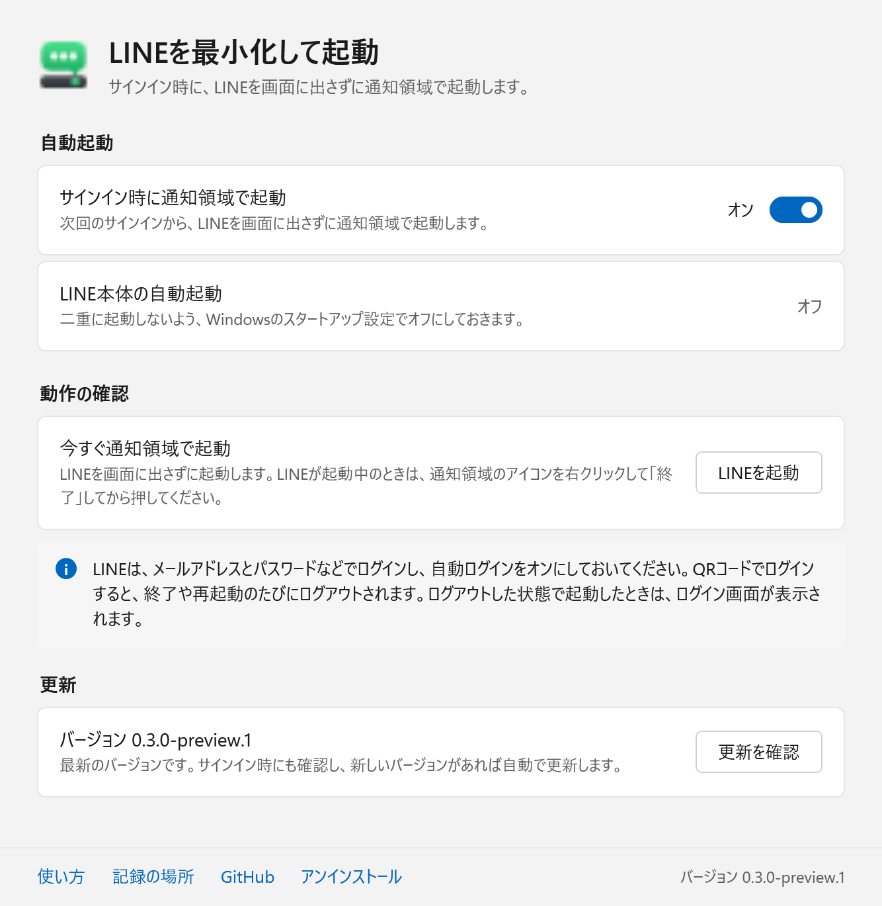
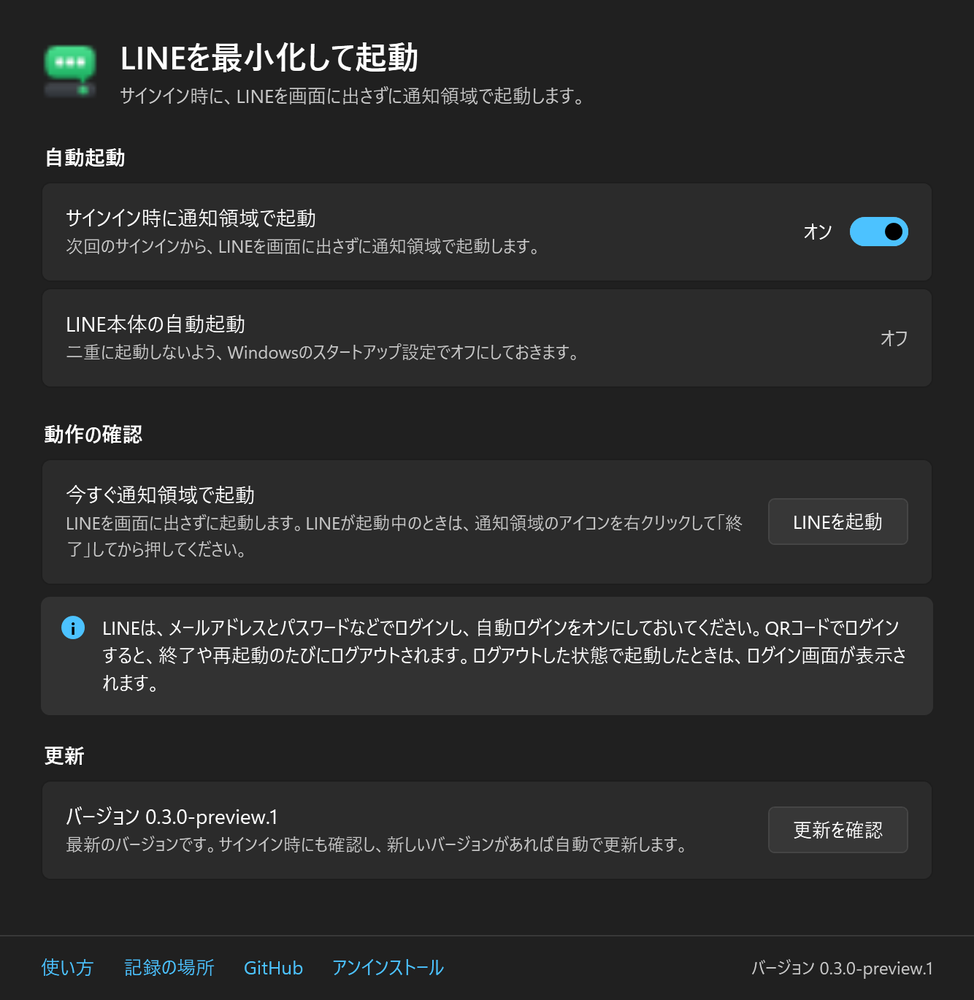
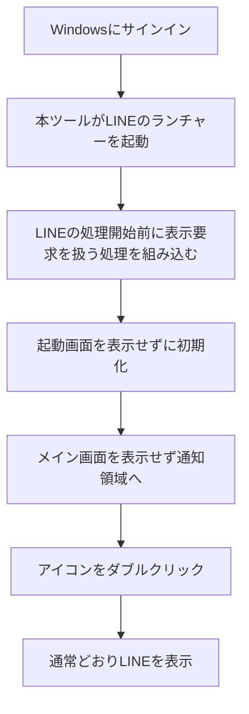

# LINEを最小化して起動

**PC起動時、LINEの画面を出さずに通知領域へ。**

Windowsへのサインイン時にLINEを起動し、タスクバー右端の通知領域（タスクトレイ）へ常駐させる非公式ツールです。LINEを開きたいときは、通知領域のLINEアイコンをダブルクリックします。

**[セットアップEXEをダウンロード](https://github.com/hinatamaxxx/windows-line-start-to-tray/releases/download/v0.3.0-preview.1/WindowsLineStartToTray-Setup-0.3.0-preview.1.exe)** · [リリース一覧](https://github.com/hinatamaxxx/windows-line-start-to-tray/releases)

> 現在は **v0.3.0-preview.1（プレビュー版）** です。アプリを作り直し、名前を「Windows版LINEを通知領域で起動」から「LINEを最小化して起動」に変えました。インストール、自動更新、Windowsの設定からのアンインストールに対応しています。修正版でのPC再起動は未確認です。詳しくは下の「検証状況」をご覧ください。

ダークテーマの画面を見る

画面の配色はWindowsのライト／ダークとアクセントカラーに合わせて自動で切り替わります。

## セットアップ

### 1. LINEを準備する

- Windows版LINEをインストールし、メールアドレスとパスワード（または「スマートフォンを使ってログイン」）でログインしておきます。**QRコードでログインすると、自動ログインをONにしても終了のたびにログアウトされます。**
- LINE本体の設定で自動ログインをONにします。

### 2. セットアップEXEを開く

上のダウンロードリンクから `WindowsLineStartToTray-Setup-0.3.0-preview.1.exe` を保存し、ダブルクリックします。インストールは自動で進み、終わると設定画面が開きます。

- 管理者権限、コマンド入力、GitやVisual Studioのインストールは不要です。インストール中の追加ダウンロードもありません。
- 配布EXEにはコード署名がないため、Windowsが「WindowsによってPCが保護されました」と表示することがあります。入手元がこのリポジトリのReleasesであることを確認し、「詳細情報」→「実行」を押してください。
- GitHubのリリースページから選ぶ場合は、Assets内のセットアップEXEをダウンロードします。`.nupkg` や `releases.win.json` は自動更新用のファイルです。

### 3. 自動起動をオンにする

設定画面の「サインイン時に通知領域で起動」をオンにします。Windowsのスタートアップに登録され、次回のサインインから自動で起動します。

LINE本体の自動起動がオンになっている場合は、画面の上に案内が出ます。「設定を開く」を押し、Windowsのスタートアップ設定で「LINE」をオフにしてください。両方オンのままだと、LINEが通常の画面でも開きます。

### 4. 動作を確認する

1. 通知領域のLINEアイコンを右クリックして「終了」します。ウィンドウ右上の「×」だけでは終了しません。
2. 設定画面の「LINEを起動」を押します。
3. LINEの画面が出ず、通知領域にアイコンが入ることを確認します。タスクバーに見当たらないときは、右端の「^」を開くと見つかります。
4. アイコンをダブルクリックし、LINEがログインした状態で開くことを確認します。

## 毎日の使い方

| やりたいこと | 操作 |
| --- | --- |
| LINEを開く | 通知領域のLINEアイコンをダブルクリック（見当たらないときは「^」の中） |
| LINEを終了する | 通知領域のアイコンを右クリック →「終了」 |
| 設定画面を開く | スタートメニューで「LINEを最小化して起動」を開く |
| 自動起動をやめる | 設定画面のスイッチをオフ、またはWindowsの「設定 → アプリ → スタートアップ」でオフ |

通常のLINEショートカットから起動した場合は、本ツールを通さず通常どおり開きます。LINEがログアウトした状態で起動したときは、ログイン画面を隠さずに表示します。

## 更新

新しいバージョンは自動で入ります。サインイン時の起動でこのリポジトリのReleasesを確認し、新しいバージョンがあれば、LINEを起動したあとに裏で入れ替えます。設定画面の「更新を確認」から手動で更新することもできます。

ダウンロードはHTTPSで行い、Velopackがリリースに記録されたハッシュと照合してから入れ替えます。更新に失敗した場合は、今のバージョンのまま動きます。

## アンインストール

Windowsの「設定 → アプリ → インストールされているアプリ」で「LINEを最小化して起動」を選んでアンインストールします。設定画面の下にある「アンインストール」からも行えます。

- 既定では本体、スタートメニューと自動起動のショートカット、記録（ログ）をすべて削除します。確認画面で「設定とデータを残す」にチェックを入れたときだけ、記録を残します。
- LINE本体とLINEのログイン情報は削除しません。
- LINE本体の自動起動をオフにしていた場合は、アンインストールのあとに、Windowsのスタートアップ設定で「LINE」をオンに戻してください。本ツールは、Windowsが記録するスタートアップのオン/オフを書き換えません。
- コマンドで実行する場合は、`%LOCALAPPDATA%\WindowsLineStartToTray\current\LineMinimizedStart.exe --uninstall` を使います。`-Quiet`（確認なしで全削除）と `-KeepSettings`（記録を残す）を付けられます。

## 変更するファイルとレジストリ

| 種類 | 場所 | 内容 |
| --- | --- | --- |
| 本体 | `%LOCALAPPDATA%\WindowsLineStartToTray\` | Velopackが管理するインストール先。`current\` に本体、補助EXE、補助DLLが入ります |
| 記録 | `%LOCALAPPDATA%\LineTrayStartup\` | `diagnostic.log`、`app.log`、LINEに読み込ませる補助DLLの写し（`hook\`） |
| スタートメニュー | `%APPDATA%\Microsoft\Windows\Start Menu\Programs\LINEを最小化して起動.lnk` | 設定画面を開くショートカット |
| 自動起動 | `%APPDATA%\Microsoft\Windows\Start Menu\Programs\Startup\LINEを最小化して起動.lnk` | 自動起動をオンにしたときだけ作ります |
| レジストリ | `HKCU\Software\Microsoft\Windows\CurrentVersion\Uninstall\WindowsLineStartToTray` | 「インストールされているアプリ」に表示するための情報。Velopackが作り、アンインストールで消します |

レジストリに書くのは、上のアンインストール情報1か所だけです。自動起動はスタートアップフォルダーのショートカットで行い、Windowsが記録するスタートアップのオン/オフ（`StartupApproved`）は読むだけです。LINE本体の実行ファイルとログイン情報も変更しません。

## どうやって画面を出さずに起動するの？

LINEがWindowsに **「このウィンドウを表示して」** と依頼するタイミングで、その表示要求を処理します。

起動画面は表示せずに初期化を進めます。メイン画面も最初の表示を抑えたまま、LINE本来の「閉じる」処理を呼び、通知領域へ移します。その後は通常の表示操作を許可するため、アイコンをダブルクリックすればLINEを開けます。

ログアウトした状態で起動した場合は、ログイン画面を隠さずにそのまま表示します。ログイン画面はメイン画面と同じ種類のウィンドウですが、最大化ボタンがないことで見分けています。

### 実装のポイント

- **表示する前に処理します。** ウィンドウが出るのを一定間隔で探す監視ループや、時間を決めて待つ処理は使っていません。
- **LINE本来のランチャーを使います。** `LineLauncher.exe --booting` を呼び出し、ランチャーから本体への起動にも処理を引き継ぎます。
- **接続画面も表示前に抑えます。** 「Connecting to LINE」は、LINE本体とは別にランチャーが出す画面です。ランチャー内の専用ウィンドウ（`SPLASH`）を対象に、作成時の表示指定と表示要求を抑えます。接続処理はそのまま進めます。
- **更新プロセスにも補助処理を引き継ぎます。** LINEから更新プログラム、新しいLINEへ処理を引き継ぎます。
- **メモリ上に補助処理を組み込みます。** Microsoftの[Detours](https://github.com/microsoft/Detours)を使い、Windowsの表示APIを呼ぶ経路に補助DLLを入れます。この仕組みを「フック」と呼びます。ディスク上のLINE実行ファイルは変更しません。
- **補助DLLは写しを読み込ませます。** LINEは起動中ずっと補助DLLを読み込んだままにします。本体のファイルを更新で入れ替えられるよう、起動用EXEが記録フォルダーへ写したものを読み込ませます。
- **常駐監視用の別プロセスは残しません。** 起動用EXEは処理後に終了し、補助DLLはLINEのプロセス内に残ります。

より詳しい処理の流れとソースコードの対応は、[実装の説明](docs/architecture.md)をご覧ください。

### 通知領域のLINEアイコンはどう設定しているの？

**PCにインストールされているLINE本体（`LINE.exe`）に埋め込まれたロゴを使い、LINEが通知領域のアイコンで示す状態を重ねます。** 利用者が画像を用意したり、アイコンを手動で設定したりする必要はありません。

| LINEの状態 | LINE本来の通知領域アイコン | 本ツールが表示するアイコン |
| --- | --- | --- |
| 接続中（起動直後など） | 灰色 | ロゴを灰色にしたもの |
| 接続済み | 緑 | ロゴ |
| 未読あり | 緑に「N」の印 | ロゴに、LINE本来の「N」の印を重ねたもの |

1. LINEがWindowsへ通知領域アイコンの登録・更新を要求するたびに、LINEが渡したアイコンの画素を調べます。ほとんど色がなければ接続中、オレンジの画素のかたまりがあれば未読ありと判断します。
2. LINE本体から同じ大きさのロゴを取り出し、接続中なら灰色にし、未読ありならLINEのアイコンにある「N」の印の画素を同じ位置に重ねます。
3. ダブルクリックや右クリックなどの操作は、引き続きLINE本体が処理します。

この処理は動作中のメモリ上で行い、**ディスク上のLINE本体やアイコンを書き換えません。LINE本体やそのアイコン画像を本ツールに同梱して再配布することもありません。** 設定画面とスタートメニューには、本ツール独自のアイコンを使っています。

該当するコードは [Hook.cpp の `ComposeTrayIcon`](native/Hook.cpp) にあります。合成できなかった場合はロゴをそのまま使い、ロゴも取り出せなかった場合はLINEが指定した元のアイコンを使います。状態の判定は色をもとにしているため、LINEがアイコンのデザインを変えると、灰色や「N」の印が出なくなる場合があります。

## 旧版からの移行

「Windows版LINEを通知領域で起動」（v0.2.0-preview.9まで）を使っている場合も、新しいセットアップEXEを開くだけで移行します。

- 旧版の自動起動（`HKCU\...\Run` の `WindowsLineStartToTray`）がオンだった場合は、スタートアップフォルダーのショートカットに置き換えます。旧版が作った `Run` と `StartupApproved\Run` の値は削除します。
- `LineTrayStartup` フォルダーにあった旧版のプログラムとバックアップは削除し、`diagnostic.log` は残します。LINEが読み込み中のファイルは、次回の起動時に削除します。
- 旧版のセットアップ画面へのスタートメニュー項目は削除します。
- LINE本体の自動起動の状態（旧版がオフにしたもの）は変えません。

## 検証状況

| 検証 | 結果 |
| --- | --- |
| LINE 26.4.2.3957の実機動作（旧版） | 非表示起動・アイコンからの再表示・ログイン維持を確認。2026年9月30日に再起動後の非表示とLINEアイコン表示を利用者が確認 |
| 更新経路の模擬テスト | 32/64bitのプロセスとANSI/Unicodeの起動APIを経由した引き継ぎ、初回表示の抑制、その後の再表示を確認 |
| ログイン画面の模擬テスト | 最大化ボタンのないメイン画面を表示し、閉じる処理を送らないことを確認 |
| ランチャー接続画面の模擬テスト | 作成時の表示指定と同期・非同期の表示要求を抑え、対象外のウィンドウが表示できることを確認 |
| preview.8とLINE 26.5.0.3975の実機起動（2026年10月19日） | ログイン済みでは接続画面・起動画面・メイン画面を抑えて通知領域へ移ることを、ログアウト状態ではログイン画面が表示されることを、それぞれログとウィンドウ状態で確認 |
| v0.3.0の設定アプリのテスト（2026年10月20日） | 自動起動のオン/オフ、Windows側でオフにしたときの表示、LINE本体の自動起動の判定、旧版と旧名からの移行、アンインストール時の削除（残す/すべて）を、独立したテスト領域で確認 |
| v0.3.0の実機導入（2026年10月20日） | v0.2.0-preview.9からの移行で自動起動のショートカットへの置き換え、「インストールされているアプリ」への登録、スタートメニューのアイコン表示を確認。補助DLLの写しから読み込ませて起動できることを模擬テストで確認 |
| 通知領域アイコンの合成（2026年10月20日） | 実機で保存したLINE 26.5.0.3975のアイコン（接続中・接続済み・未読あり）を入力に、灰色と「N」の印を正しく重ねることを確認。テスト用の画像による模擬テストも用意 |
| 実際のLINE自動更新の再実行・修正版でのPC再起動 | 未確認 |

## 対応環境と制約

| 項目 | 内容 |
| --- | --- |
| 対象OS | Windows 10 / 11、x64。.NET Framework 4.8（Windowsに標準で入っています） |
| LINE | `%LOCALAPPDATA%\LINE\bin\LineLauncher.exe` があるデスクトップ版。Microsoft Storeからインストールした環境で確認 |
| Windows ARM / 32bit OS | 対象外 |
| 権限 | 現在ログインしているユーザーに導入。管理者権限は不要 |

- LINEの更新で内部構造が変わると、動作しなくなる場合があります。
- 通知領域アイコンの接続中・未読の表示は、LINEのアイコンの色から判定します。LINEがアイコンのデザインを変えると、表示されなくなる場合があります。
- LINE自体の認証切れを防ぐツールではありません。再認証が必要な場合は、LINEを開いてログインしてください。

## 困ったとき

### PCを起動するたびにLINEがログアウトしている

**QRコードでログインしていないか確認してください。** PC版LINEはQRコードでログインすると、自動ログインをONにしても、終了や再起動のたびにログアウトされます。本ツールを使わない通常の起動でも同じです。メールアドレスとパスワード、または「スマートフォンを使ってログイン」でログインし直してください。

PC版LINEに同時にログインできるPCは1台です。別のPCでログインすると、先にログインしていたPCはログアウトされます。

### 通知領域にLINEのアイコンが見当たらない

タスクバー右端の「^」を開いてください。新しく通知領域に入ったアイコンは、最初はこの中に入ります。いつも表示したい場合は、Windowsの「設定 → 個人用設定 → タスクバー → その他のシステムトレイアイコン」でLINEをオンにします。

### サインイン時にLINEの通常の画面が開く

LINE本体の自動起動がオンになっていないか、設定画面で確認してください。オンになっている場合は、画面の上に案内が出ます。Windowsのスタートアップ設定で「LINE」をオフにします。

### 「LINEを起動」を押してもLINEが起動しない

LINEがすでに起動している場合は、新しく起動しません。通知領域のアイコンを右クリックして「終了」してから押してください。

LINEが `%LOCALAPPDATA%\LINE\bin` にインストールされているかも確認してください。別の場所にインストールしたLINEは、この版では自動検出できません。

### 不具合を報告する

[Issues](https://github.com/hinatamaxxx/windows-line-start-to-tray/issues)に、WindowsとLINEのバージョン、どの操作で起きたかを添えて報告してください。設定画面の「記録の場所」を押すと開くフォルダーに、`diagnostic.log` と `app.log` があります。処理名・プロセスID・ウィンドウクラス・数値を記録し、会話本文や認証情報は記録しません。

## 開発者向け

自分でビルドする場合は、[ビルドとテストの手順](docs/development.md)をご覧ください。通常の利用にはビルドは不要です。

## 開発に使用したAIモデル

このツールは利用者の要望と実機での確認をもとに、AIコーディングツールを使って開発しました。開発記録で確認できたモデルは次のとおりです。

| 用途 | ツール | 使用モデル |
| --- | --- | --- |
| v0.2までの設計・実装・テスト・ドキュメント作成 | OpenAI Codex | `gpt-6-astra`、`gpt-6-sol`、`gpt-6-luna` |
| 再起動時の不具合修正 | OpenAI Codex | Astra（`gpt-6-astra`）、GPT-6.1 Sol（`gpt-6.1-sol`、Ultra / Fast） |
| 利用者向けの説明文の校正 | Antigravity CLI | Gemini 3.8 Flash (High) |
| v0.2.0-preview.8以降の調査・修正、v0.3.0の作り直し（設定画面・アイコン・インストーラー）、文章の推敲 | Claude Code | Claude Opus 5.5（`claude-opus-5-5`） |

これらは開発時に使用したものです。本ツールを利用するために、AIサービスのアカウントやAPIキーは必要ありません。

本ツールのライセンスは[MIT](LICENSE)です。Microsoft Detoursにも[MITライセンス](third_party/Detours/LICENSE.md)が適用されます。インストーラーと更新には[Velopack](https://github.com/velopack/velopack)（MITライセンス）を使っています。LINEの名称とロゴは権利者に帰属します。本ツールはLINE公式が提供・サポートするものではありません。
